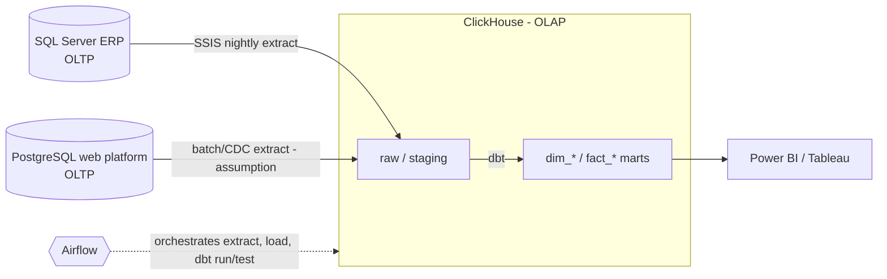

# Data Engineering Technical Assessment

The Excel ingestion pipeline is in `pipeline/` (see `README.md`).

---

## Part 1: Architecture & Modeling Challenge

### Task 1.1: Storage Architecture Strategy

#### 1. Warehouse vs Lake vs Lakehouse — recommendation

| | Traditional DWH | Data Lake | Lakehouse |
|---|---|---|---|
| Data | Structured, modeled (star schemas) | Raw files of any shape, usually on object storage | Open table formats on object storage, with ACID/metadata layer |
| Schema | On write | On read | Both |
| Strengths | Fast, predictable BI/SQL; governance | Cheap, flexible, ML/raw retention | One copy for BI + ML |
| Weaknesses | Less flexible for unstructured data | Weak governance/performance without extra layers | More moving parts |
| Fit here | **Strong**: sources are two relational DBs; needs are cohort analysis, funnels, dashboards | Little need: no unstructured data is mentioned | Possible later; not required by the stated needs |

**Recommendation [Practice, grounded in the stated stack]:** a **warehouse-style architecture with ClickHouse as the analytical (OLAP) store**, ELT with dbt, orchestrated by Airflow. The assessment names ClickHouse/PostgreSQL/dbt/Airflow and does not mention object storage, so I do not make a lake/lakehouse layer mandatory. *Optional* (not required): add object-storage raw retention if later needs include replay at scale, semi-structured data or ML.

**OLTP vs OLAP.** OLTP (the ERP SQL Server and the e-commerce PostgreSQL) serves many small concurrent reads/writes of individual rows, normalized, with strict transactional guarantees. OLAP (ClickHouse) serves fewer, large scans and aggregations over history, columnar and denormalized/dimensional. Analytics here (cohorts, funnels, executive dashboards) is OLAP.



**Roles.** *SQL Server*: source of store sales/customers. *SSIS*: existing nightly extract/load; keeping it initially limits migration risk **[Assumption]**. *PostgreSQL (web)*: source of traffic and registrations; the PDF also lists PostgreSQL in the target stack without saying what it does there — **open question** (my assumption: it stays an OLTP source, and optionally holds metadata). *ClickHouse*: analytical store. *dbt*: SQL transformations, tests, lineage. *Airflow*: scheduling, dependencies, retries, alerting.
#### 2. Power BI / Tableau on production PostgreSQL

Connecting dashboards directly to the **production** OLTP Postgres is a false economy:

- **Locks & contention:** Analytical scans compete with OLTP writes; long queries hold buffers and can block or slow checkouts/registrations.
- **I/O & cache pollution:** Full-table or large-range scans push hot transactional pages out of shared buffers.
- **No columnar / MPP scan path:** Row-store Postgres is optimized for point lookups and short transactions, not wide historical aggregations. Warehouses/ClickHouse use columnar storage, compression, and vectorized execution.
- **Schema coupling:** Report models freeze production tables; product changes become dashboard breakages.
- **Security & blast radius:** Broad read access to PII/transaction tables increases risk.

Use a replica at minimum, and preferably curated OLAP tables fed by Airflow/dbt.

---

### Task 1.2: Dimension & Fact Modeling

**A. Conformed `dim_customers`.** Business identity is `(source_system, source_customer_id)`; IDs are **not** assumed globally unique. A `customer_id_map` table maps each source ID to one surrogate `customer_key`; facts reference only the surrogate key. Challenges: same person with several web accounts or in both systems; shared/typo'd/missing emails and phones; Arabic/English or spelling variants of names; guests with no account; merges/splits discovered later (re-pointing keys, history); privacy/consent for PII. *Matching rules are not specified by the assessment.* **[Assumption/proposal]**: deterministic rules first (exact normalized email, then phone), a review queue for fuzzy matches, `match_rule` recorded for auditability.

**B. Junk dimension.** Small, independent, low-cardinality flags are combined into one dimension `dim_order_profile` (one row per *combination*), and the fact stores a single small key. Here 3 × 3 × 2 = 18 possible combinations. It keeps the fact narrow and avoids three tiny dimensions. Whether all 18 occur is **unknown**; the DDL pre-loads all 18 **[Assumption]**, or load only observed combos and add new ones as they arrive.

**C. SCD Type 2 (address).** Each change expires the current row (`effective_to`, `is_current=false`) and inserts a new row (`effective_from`, `effective_to=NULL`, `is_current=true`); facts join on the version valid at order time, so sales are attributed to the region at purchase time. **Verified** on PG 16: initial load, an unchanged re-run (adds nothing), a move, a brand-new customer, the point-in-time join, and a one-current-row-per-customer unique partial index. **[Assumption]** half-open `[from, to)` intervals and timestamp (not date) granularity; two changes in the same instant would need a sequence/tie-break (not tested). A dbt `snapshot` outline is in the SQL file (check the ClickHouse adapter's snapshot support for your versions; not verified here).

**D. SCD Type 3 (loyalty tier).** Columns `loyalty_tier_current`, `loyalty_tier_previous` (+ optional change timestamp) on the **same customer row**; update shifts current → previous then sets the new tier, only when the value changed. **Verified** on PG 16. SCD2 adds rows and keeps full history; SCD3 overwrites in place and keeps one prior value.


---

## Part 2: Data Pipelines & Performance Optimization

### Task 2.1: SSIS Lookup Cache Modes

#### 1. Modes

| Mode | Behavior |
|---|---|
| **Full Cache** | Load entire reference set into memory before rows flow; fastest lookups; highest memory |
| **Partial Cache** | Cache entries as they are looked up (with size limit); miss → query DB, then cache |
| **No Cache** | Every row hits the database; lowest memory; most round-trips |

#### 2. Choice for OOM + top-100 products

Use **Partial Cache**. Full Cache on 15M products caused OOM. Partial Cache keeps the hot ~100 products in memory after first hits (covering ~95% of traffic) while avoiding loading the full dimension. No Cache would thrash the DB with per-row lookups.

Optionally pre-seed a small reference query for the top 100 SKUs and keep cache size capped to that working set.

#### 3. No-match row redirection

Configure the Lookup error output (or “Redirect rows to no match output”) to send unmatched product keys to an error/quarantine path: log `order_id`, `product_id`, package execution id; do not silently drop. Optionally default `category_id` only in a controlled downstream path after review.

---

### Task 2.2: ClickHouse Partitioning & Ordering

#### 1. Strategy for `user_sessions`

- **PARTITION BY** `toYYYYMM(event_date)` (monthly). Matches retention, tiered storage, and partition pruning for date-bounded funnels.
- **ORDER BY** `(user_id, event_time)` (primary key / sorting key). Enables efficient per-user session scans and sparse index granules on `user_id`.

Also keep `event_date` as a proper Date column for partition expression clarity.

#### 2. Why not `user_id` or millisecond timestamp partitions

ClickHouse performs best with a **modest** number of partitions (typically dozens to low hundreds, not millions). Partitioning by `user_id` or `toUnixTimestamp64Milli(event_time)` creates an explosion of parts:

- Heavy merge scheduler load and “too many parts” errors
- Poor insert batching and memory overhead per part
- Ineffective pruning (queries rarely hit one user partition usefully at lake scale)

Use partitions for coarse time (or large tenant), and put selective columns in `ORDER BY`, not in `PARTITION BY`.

---

## Part 3: SQL & Linux Hands-on Mastery

### Task 3.1: Logical order & window rewrite

#### 1. Logical clause order

For the given query shape, logical processing is:

1. `FROM`
2. `WHERE`
3. `GROUP BY`
4. `HAVING`
5. **Window** (`OVER` / `LAG` / `LEAD`) — evaluated after `HAVING`, on the grouped result
6. `SELECT` (including window outputs)
7. (`ORDER BY` / `LIMIT` if present — not in the given query)

#### 2. The bug and rewrite

`LAG`/`LEAD` run **after** `GROUP BY`/`HAVING`. Grouping to `(user_id, page_id, visit_time)` collapses duplicates before the window, so “page transitions” are computed on the aggregated grain, not the filtered raw hit stream. `HAVING COUNT(*) > 1` also does not mean “keep pages with more than one interaction globally”—it filters groups after aggregation.

Correct pattern: aggregate/filter in a CTE, then apply windows on the filtered detail (or on the intended grain):

```sql
WITH page_counts AS (
  SELECT user_id, page_id
  FROM web_traffic
  WHERE visit_time >= DATE '2026-07-01'
  GROUP BY user_id, page_id
  HAVING COUNT(*) > 1
),
filtered AS (
  SELECT w.user_id, w.page_id, w.visit_time
  FROM web_traffic w
  INNER JOIN page_counts p
    ON w.user_id = p.user_id
   AND w.page_id = p.page_id
  WHERE w.visit_time >= DATE '2026-07-01'
)
SELECT
  user_id,
  page_id,
  visit_time,
  LAG(page_id)  OVER (PARTITION BY user_id ORDER BY visit_time) AS previous_page,
  LEAD(page_id) OVER (PARTITION BY user_id ORDER BY visit_time) AS next_page
FROM filtered;
```

---

### Task 3.2: De-duplication DML

#### 1. Delete duplicates, keep earliest `load_timestamp`

```sql
DELETE FROM raw_orders a
USING raw_orders b
WHERE a.order_id = b.order_id
  AND a.load_timestamp > b.load_timestamp;
```

If timestamps can tie, add a tie-breaker (e.g. `ctid`):

```sql
DELETE FROM raw_orders a
USING raw_orders b
WHERE a.order_id = b.order_id
  AND (
        a.load_timestamp > b.load_timestamp
     OR (a.load_timestamp = b.load_timestamp AND a.ctid > b.ctid)
      );
```

#### 2. Why `NOT IN` deletes fail at 100M rows — alternative

A `DELETE ... WHERE ctid NOT IN (SELECT ...)` style plan often:

- Builds a huge anti-join / materializes massive ID lists
- Causes long transactions, bloat, and WAL spikes
- Holds locks that block ingest

**Better at scale:** build a clean table, then swap:

```sql
CREATE TABLE raw_orders_dedup AS
SELECT DISTINCT ON (order_id) *
FROM raw_orders
ORDER BY order_id, load_timestamp ASC, ctid ASC;

BEGIN;
ALTER TABLE raw_orders RENAME TO raw_orders_old;
ALTER TABLE raw_orders_dedup RENAME TO raw_orders;
COMMIT;
-- recreate indexes/constraints; DROP raw_orders_old after validation
```

Or batch deletes by `order_id` ranges in Airflow to keep transactions small.

---

### Task 3.3: Linux & Logs

#### 1. Find and kill the process on port 8080

```bash
# identify listener
sudo lsof -iTCP:8080 -sTCP:LISTEN -n -P
# or: sudo fuser 8080/tcp

# forceful terminate (replace <PID>)
sudo kill -9 <PID>

# one-liner variants:
sudo fuser -k 8080/tcp
# or: kill -9 $(sudo lsof -t -iTCP:8080 -sTCP:LISTEN)
```

#### 2. Search a 10 GB log with context (no editor)

```bash
grep -n -C 5 'OutOfMemoryError' /var/log/airflow/dag_execution.log
```

---

## Excel Pipeline — Scalability Note

The sample workbook is processed **one sheet at a time** with pandas; values are melted to long form and written to CSV without holding hundreds of workbooks in memory.

For hundreds of files:

- **Process files sequentially or with a bounded process pool** (multiprocessing/Celery workers), one workbook per worker.
- **Do not materialize the full lake of workbooks** in a single DataFrame; stream writes (`to_csv` append or per-file outputs then concatenate).
- **Orchestrate with Airflow:** each file (or batch of N files) is a task; retries and backpressure prevent memory collapse.
- **Normalize in vectorized pandas/pyarrow**, not cell-by-cell Python over the entire archive.

See `README.md` and `pipeline/` for the implementation.
