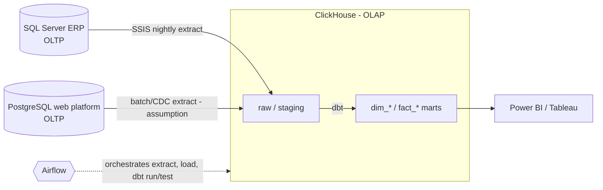

# Data Engineering Technical Assessment

The Excel ingestion pipeline is in `pipeline/` (see `README.md`).

---

## Part 1: Architecture & Modeling Challenge

### Task 1.1: Storage Architecture Strategy

#### 1. Warehouse vs Lake vs Lakehouse — recommendation

| | Traditional DWH | Data Lake | Lakehouse |
|---|---|---|---|
| Data | Structured, modeled (star schemas) | Raw files of any shape, usually on object storage | Open table formats on object storage, with ACID/metadata layer |
| Schema | On write | On read | Both |
| Strengths | Fast, predictable BI/SQL; governance | Cheap, flexible, ML/raw retention | One copy for BI + ML |
| Weaknesses | Less flexible for unstructured data | Weak governance/performance without extra layers | More moving parts |
| Fit here | **Strong**: sources are two relational DBs; needs are cohort analysis, funnels, dashboards | Little need: no unstructured data is mentioned | Possible later; not required by the stated needs |

**Recommendation [Practice, grounded in the stated stack]:** a **warehouse-style architecture with ClickHouse as the analytical (OLAP) store**, ELT with dbt, orchestrated by Airflow. The assessment names ClickHouse/PostgreSQL/dbt/Airflow and does not mention object storage, so I do not make a lake/lakehouse layer mandatory. *Optional* (not required): add object-storage raw retention if later needs include replay at scale, semi-structured data or ML.

**OLTP vs OLAP.** OLTP (the ERP SQL Server and the e-commerce PostgreSQL) serves many small concurrent reads/writes of individual rows, normalized, with strict transactional guarantees. OLAP (ClickHouse) serves fewer, large scans and aggregations over history, columnar and denormalized/dimensional. Analytics here (cohorts, funnels, executive dashboards) is OLAP.



**Roles.** *SQL Server*: source of store sales/customers. *SSIS*: existing nightly extract/load; keeping it initially limits migration risk **[Assumption]**. *PostgreSQL (web)*: source of traffic and registrations; the PDF also lists PostgreSQL in the target stack without saying what it does there — **open question** (my assumption: it stays an OLTP source, and optionally holds metadata). *ClickHouse*: analytical store. *dbt*: SQL transformations, tests, lineage. *Airflow*: scheduling, dependencies, retries, alerting.
#### 2. Power BI / Tableau on production PostgreSQL

Connecting dashboards directly to the **production** OLTP Postgres is a false economy:

- **Locks & contention:** Analytical scans compete with OLTP writes; long queries hold buffers and can block or slow checkouts/registrations.
- **I/O & cache pollution:** Full-table or large-range scans push hot transactional pages out of shared buffers.
- **It cannot answer the business question:** ERP data is in SQL Server, so "store sales + web traffic" cannot be joined inside the web PostgreSQL without moving data anyway.
- **Schema coupling:** Report models freeze production tables; product changes become dashboard breakages.
- **Security & blast radius:** Broad read access to PII/transaction tables increases risk.

Use a replica at minimum, and preferably curated OLAP tables fed by Airflow/dbt.

---

### Task 1.2: Dimension & Fact Modeling

**A. Conformed `dim_customers`.** Business identity is `(source_system, source_customer_id)`; IDs are **not** assumed globally unique. A `customer_id_map` table maps each source ID to one surrogate `customer_key`; facts reference only the surrogate key. Challenges: same person with several web accounts or in both systems; shared/typo'd/missing emails and phones; Arabic/English or spelling variants of names; guests with no account; merges/splits discovered later (re-pointing keys, history); privacy/consent for PII. *Matching rules are not specified by the assessment.* **[Assumption/proposal]**: deterministic rules first (exact normalized email, then phone), a review queue for fuzzy matches, `match_rule` recorded for auditability.

**B. Junk dimension.** Small, independent, low-cardinality flags are combined into one dimension `dim_order_profile` (one row per *combination*), and the fact stores a single small key. Here 3 × 3 × 2 = 18 possible combinations. It keeps the fact narrow and avoids three tiny dimensions. Whether all 18 occur is **unknown**; the DDL pre-loads all 18 **[Assumption]**, or load only observed combos and add new ones as they arrive.

**C. SCD Type 2 (address).** Each change expires the current row (`effective_to`, `is_current=false`) and inserts a new row (`effective_from`, `effective_to=NULL`, `is_current=true`); facts join on the version valid at order time, so sales are attributed to the region at purchase time. **Verified** on PG 16: initial load, an unchanged re-run (adds nothing), a move, a brand-new customer, the point-in-time join, and a one-current-row-per-customer unique partial index. **[Assumption]** half-open `[from, to)` intervals and timestamp (not date) granularity; two changes in the same instant would need a sequence/tie-break (not tested). A dbt `snapshot` outline is in the SQL file (check the ClickHouse adapter's snapshot support for your versions; not verified here).

**D. SCD Type 3 (loyalty tier).** Columns `loyalty_tier_current`, `loyalty_tier_previous` (+ optional change timestamp) on the **same customer row**; update shifts current → previous then sets the new tier, only when the value changed. Proposed Logical Design in SQL Folder. SCD2 adds rows and keeps full history; SCD3 overwrites in place and keeps one prior value.


---

## Part 2: Data Pipelines & Performance Optimization

### Task 2.1: SSIS Lookup Cache Modes

**Cache modes.** *Full cache*: the whole reference result set is loaded into memory before rows flow; fastest per row, no per-row DB calls, memory = size of the loaded result set. *Partial cache*: starts empty; rows are cached as lookups succeed (up to a configured cache size); a miss queries the database; there is an option to also cache "not found" keys. *No cache*: every input row issues a database query; least memory, most round-trips.

**Recommendation.** For the stated facts (15 M-row dimension, out-of-memory today, 95 % of transactions on 100 products) **Partial Cache** is the natural choice: the ~100 hot products are cached after their first lookups, so ~95 % of rows should avoid the DB, and memory stays bounded. Trade-off: the remaining ~5 % (long tail) mostly hit the DB at least once per distinct key; hit-rate depends on the real distribution, cache size and row order, none of which I have — so **treat the expected benefit as a hypothesis to measure**, not a guarantee.
Before changing modes, check what the Lookup query selects: loading the whole table with many columns is the usual cause of the memory failure; selecting only the product key and category ID, and filtering to needed rows, reduces memory in every mode. Full Cache on a *narrowed* query may even fit — measure it. Optional optimization (needs testing): a first Lookup in Full Cache on just the top-100 products, with its no-match output feeding a second Partial/No-Cache Lookup against the full table; it adds complexity and assumes the hot set is stable.

**Row redirection.** Set the Lookup's no-match behavior to *Redirect rows to no match output* (not *Ignore failure*, which leaves NULL category silently, and not *Fail component*, which stops the package). Send that output to a quarantine/error table (order id, product id, source timestamp, package run id) and either (a) load the rows into the fact with an "Unknown" product member, or (b) hold them until the dimension catches up — a business choice **[open question]**. Reprocess quarantined rows after the product dimension loads. Monitor the quarantine row count.
---

### Task 2.2: ClickHouse Partitioning & Ordering

1- columns `user_id`, `session_id`, `session_start` **[Assumption]**.

```sql
CREATE TABLE user_sessions (
    user_id       UInt64,
    session_id    UInt64,
    session_start DateTime
)
ENGINE = MergeTree
PARTITION BY toYYYYMM(session_start)          -- coarse, time-based, low cardinality
ORDER BY (user_id, session_start);            -- primary (sparse) index
```

* **Partitioning** is mainly for data management (drop/move/TTL by period) and coarse pruning; it is *not* the main speed tool. **`ORDER BY`** defines on-disk sort order and the sparse primary index (one index entry per granule, default 8,192 rows); queries filtering on a *prefix* of the key skip most granules. **Data-skipping indexes** (minmax, set, bloom filter) are optional secondary aids for columns not in the key; they help only if the data is clustered correlated with the column.
* `(user_id, session_start)` suits "history of a user / user in a time range". If most queries are time-first aggregates across all users, a key leading with a coarse time bucket may be better; if `user_id` has very high cardinality and queries rarely filter by it, put lower-cardinality filter columns first. **To confirm before finalizing:** dominant filters, time-range sizes, ingestion rate, retention/TTL, typical result sizes.
* **2- Why `PARTITION BY user_id` or millisecond timestamp is a mistake:** cardinality → an enormous number of partitions (each partition's data lives in separate parts; parts from different partitions are never merged together). Consequences: many tiny parts, merge background work cannot keep up, insert errors such as "too many parts", more file handles/metadata, slower startup and queries that must open many parts, and in replicated setups more coordination metadata. Check the current ClickHouse documentation for exact thresholds/settings.
---

## Part 3: SQL & Linux Hands-on Mastery

### Task 3.1 (SQL: `sql/window_functions.sql`, Proposed Logical Design in SQL folder)

1. **Logical order:** `FROM → WHERE → GROUP BY → HAVING → window functions (OVER) → SELECT → (DISTINCT) → ORDER BY → LIMIT`.
2. **The bug.** **Verified:** the original query does *not* error in PostgreSQL (all its columns are grouped) — it just answers the wrong question. Grain is `(user_id, page_id, visit_time)`, so `HAVING COUNT(*) > 1` keeps only *identical duplicate events*. `LAG/LEAD` then run over those few survivors, so the "previous/next page" are not the user's real neighbouring visits. On my test data it returned one row with NULL neighbours. "Interaction" for a page is a count per **(user, page)** (or per page) — a *different grain* from the event grain.
3. **Fix:** decide qualifying `(user_id, page_id)` pairs in a CTE (`GROUP BY … HAVING COUNT(*) > 1`), join back to the raw events, then compute `LAG/LEAD` over the remaining events. Verified output: a page visited once by a user (`blog`) is removed *before* `LAG/LEAD`, so transitions skip it. Whether "low interaction" means per (user, page) or per page overall is **not stated**; both variants are in the file.
4. **Ties.** Two visits by one user with the same `visit_time` have no defined order. Adding `page_id` to `ORDER BY` only makes the result repeatable, not correct. A real tie-break needs an event id / click sequence, which the schema does not contain.

### Task 3.2 (SQL: `sql/deduplicate_orders.sql`, Proposed Logical Design in SQL folder)

`DELETE … USING (SELECT ctid, ROW_NUMBER() OVER (PARTITION BY order_id ORDER BY load_timestamp, ctid)) … WHERE rn > 1`.Verified on the PDF's sample rows plus edge cases: earliest `load_timestamp` kept; exact tie → physically-first row kept (arbitrary, not a business rule); NULL `load_timestamp` sorts last (kept only if alone); rolled back after testing. `ctid` is a physical locator, valid only within the statement.
**Why `NOT IN` is bad at 100 M rows:** a NULL in the subquery makes the predicate UNKNOWN (verified: matches 0 rows); PostgreSQL may not plan it as an anti-join (hashed subplan limited by `work_mem`); one huge DELETE creates ~one dead tuple per removed row (WAL, bloat, a long transaction, vacuum held back). **Alternative:** rebuild — `INSERT … SELECT DISTINCT ON (order_id) … ORDER BY order_id, load_timestamp`, validate counts, swap by rename, add a primary key to stop recurrence; or batched deletes. I did **not** run the rebuild at scale; I only ran `DISTINCT ON` on the small test set. Validate on a copy first.

### Task 3.3 (Linux). Verified on a test listener: `ss`, `lsof -t`, `grep -C`. `kill` was not run against anything real, and `kill -9` was never executed.

```bash
# 1) find the process listening on TCP 8080 (either one)
sudo ss -ltnp 'sport = :8080'
sudo lsof -nP -iTCP:8080 -sTCP:LISTEN
# verify it is the right process BEFORE killing
ps -p <PID> -o pid,ppid,user,etime,cmd
# terminate: try graceful first; -9 is a last resort (no cleanup, can leave locks/temp files)
kill <PID>
kill -9 <PID>
# the "one-liner" form the task asks for (only after you have verified the PID):
sudo kill -9 $(sudo lsof -t -iTCP:8080 -sTCP:LISTEN)

# 2) 5 lines of context before AND after each match, no editor, streams the file
grep -n -C 5 'OutOfMemoryError' /var/log/airflow/dag_execution.log
# same thing, explicit:  grep -n -B 5 -A 5 'OutOfMemoryError' ...
```
`grep` streams, so a 10 GB file is not loaded into memory; redirect (`> oom_matches.txt`) or pipe to `less` if there are many matches. `-F` (fixed string) is an option for plain text.

---


## Excel Pipeline — Scalability Note

The sample workbook is processed **one sheet at a time** with pandas; values are melted to long form and written to CSV without holding hundreds of workbooks in memory.

For hundreds of files:

- **Process files sequentially or with a bounded process pool** (multiprocessing/Celery workers), one workbook per worker.
- **Do not materialize the full lake of workbooks** in a single DataFrame; stream writes (`to_csv` append or per-file outputs then concatenate).
- **Orchestrate with Airflow:** each file (or batch of N files) is a task; retries and backpressure prevent memory collapse.
- **Normalize in vectorized pandas/pyarrow**, not cell-by-cell Python over the entire archive.

See `README.md` and `pipeline/` for the implementation.
